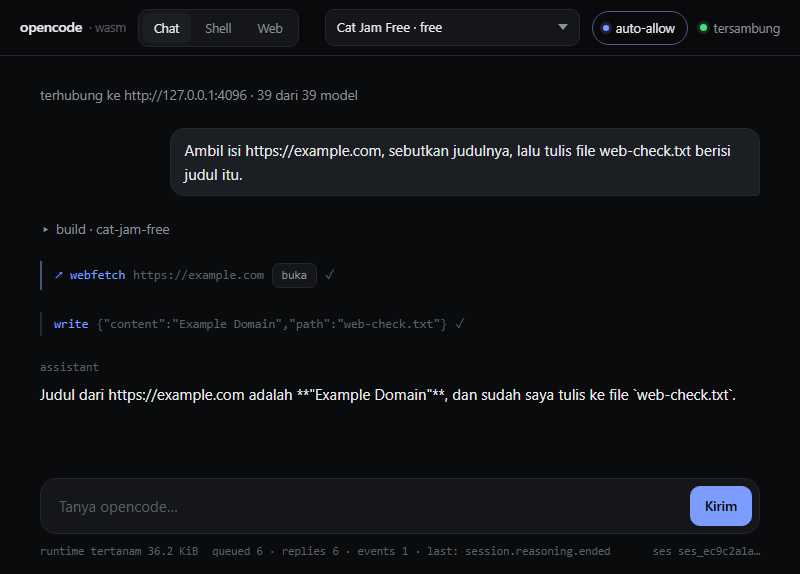
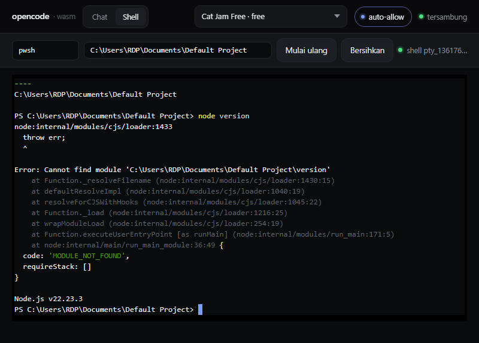

# opencode-wasm

Runtime agent [OpenCode](https://github.com/anomalyco/opencode) dipaketkan sebagai **satu file WebAssembly** dan dijalankan di browser — tanpa Node, tanpa Bun, tanpa bundler di sisi klien.

```
opencode_wasm_bg.wasm   110.8 KiB   ← satu-satunya artefak yang perlu dikirim ke browser
  └─ 36.0 KiB di dalamnya  runtime resmi opencode (@opencode/client) sebagai bytes
```

Bisa dipakai lewat HTTP (GitHub Pages) **dan** sebagai satu file HTML yang dibuka langsung dari `file://`.



## Kenapa begini, bukan `bun build --target=wasm`

Bun tidak punya target WebAssembly. `bun build --compile` hanya menghasilkan binary native:

```
bun-linux-x64 · bun-linux-arm64 · bun-linux-arm64-musl · bun-darwin-x64 · bun-darwin-arm64 · bun-windows-x64
```

Tidak ada `bun-wasm`. Ditambah opencode sangat terikat Bun (`bun:sqlite`, `@opentui/*`, `@lydell/node-pty`), jadi loop agent-nya tidak bisa dipindahkan ke wasm dalam bentuk apa pun.

Yang bisa dilakukan: **menaruh runtime resmi opencode di dalam binary wasm**. Hasilnya satu file distribusi, dan seluruh logic klien (session, streaming, izin, shell, tool web) melewati memori wasm.

## Fitur

| | |
| --- | --- |
| **Chat** | session, streaming token, ganti model saat sesi berjalan |
| **Pemilih model** | 39 model gratis opencode, group per provider, default diambil dari config server |
| **Auto-allow** | balas otomatis permintaan izin (`permission.v2.asked`) → `always`, atau kartu izin manual |
| **Shell** | PTY asli di server, dirender xterm.js, I/O lewat wasm |
| **Web tools** | `webfetch` + `websearch` milik opencode, plus panel browser dengan tombol buka |
| **Single file** | `dist/opencode-standalone.html`, jalan dari `file://` |



## Cara jalan

```bash
# 1. server opencode v2 (tidak ada rilis publik v2 → pakai snapshot dev)
npm i opencode-ai@dev --no-save --prefix tools/opencode-dev

# 2. perbaiki versi supaya free tier tidak menolak dengan HTTP 426
node scripts/patch-version.mjs tools/opencode-patched.exe 1.19.0-dev-20261013

# 3. config: model gratis + izin otomatis
node scripts/config-demo.mjs http://127.0.0.1:4096 <configPath>

# 4. jalankan
tools/opencode-patched.exe serve --port 4096 --cors http://127.0.0.1:5173
npm run serve            # http://127.0.0.1:5173/web/index.html
```

Buka halamannya, isi URL server, klik **Sambung**.

### Build sendiri

```bash
npm install
npm run build     # runtime + xterm + wasm + standalone
npm test          # unit test Rust
```

Butuh `rustup target add wasm32-unknown-unknown` dan `wasm-pack`.

## Deploy ke GitHub Pages

Situsnya terbit dari branch `main` (**Settings → Pages → Source: Deploy from a branch**, branch `main`, folder `/`).

```
https://adyoi.github.io/opencode-wasm/          → redirect ke demo
https://adyoi.github.io/opencode-wasm/web/      → demo (chat · shell · web)
https://adyoi.github.io/opencode-wasm/dist/opencode-standalone.html  → satu file
```

Karena Pages menyajikan isi repo apa adanya, hasil build ikut di-commit:

| Path | Ukuran | Isi |
| --- | --- | --- |
| `web/pkg/` | 127 KiB | `opencode_wasm_bg.wasm` + glue wasm-bindgen |
| `web/vendor/` | 343 KiB | xterm.js untuk tab Shell |
| `dist/` | 523 KiB | `opencode-standalone.html` |

Setelah mengubah `js/entry.js`, `web/app.js`, atau `web/index.html`, jalankan `npm run build`
lalu commit hasilnya. Workflow `Build & test` (.github/workflows/ci.yml) memverifikasi
bahwa yang ter-commit sama dengan hasil build — kalau tidak sama, CI gagal.

> **Trade-off:** mode branch menyimpan ±1 MB binary di riwayat git, dan workflow
> `pages-build-deployment` milik GitHub tidak bisa di-*disable* (HTTP 422) sehingga ikut
> menimpa deployment. Itu sebabnya ada `index.html` redirect di root: siapa pun yang
> menang, pengunjung tetap sampai ke demo.
> Kalau nanti mau Actions saja: `Settings → Pages → Source: GitHub Actions` — tapi
> workflow-nya sudah tidak ada, jadi harus dibuat ulang lebih dulu.

Yang bisa dari halaman HTTPS GitHub Pages:

| Fitur | Status | Catatan |
| --- | --- | --- |
| Chat, model, auto-allow, tool web | ✅ | `fetch` ke `http://127.0.0.1` diizinkan karena localhost termasuk *potentially trustworthy origin* |
| Panel Web | ✅ | iframe biasa |
| Shell / PTY | ✅ di Chromium | `ws://` ke `127.0.0.1` **terverifikasi jalan** dari halaman Pages (hasil uji di bawah). Browser lain bisa lebih ketat; `wss://` selalu aman |

Artinya untuk pemakaian sendiri: **Pages + `opencode serve` lokal sudah cukup untuk semua
fitur**, tanpa tunnel. Kalau nanti perlu diakses dari mesin lain atau browser yang lebih
ketat, arahkan server lewat TLS:

```bash
cloudflared tunnel --url http://127.0.0.1:4096     # atau ngrok http 4096
```

Lalu buka:

```
https://adyoi.github.io/opencode-wasm/?server=https://<tunnel-url>
```

Query `?server=` dipakai untuk mengarahkan halaman ke server tertentu (disimpan di `localStorage`).

### Hasil uji dari Pages (bukan localhost)

Diverifikasi langsung di `https://adyoi.github.io/opencode-wasm/` dengan server lokal yang
diizinkan lewat `--cors https://adyoi.github.io`:

```
runtime tertanam 36.0 KiB · isSecureContext = true
tersambung · 39 dari 39 model · opencode/space-bunny-free
prompt  → "Balas persis dengan tiga kata: pages live ok"
answer  → pages live ok
shell   → PowerShell 7.6.6 di dalam xterm.js
        → `hostname` dijawab `runnervmfi6oq`
```

Jadi `ws://127.0.0.1` **tidak** diblokir mixed content oleh Chromium pada kasus ini — catatan
ini menggantikan dugaan awal saya sebelumnya. Yang belum diuji: Firefox dan Safari.

### Dua hal yang perlu diperhatikan soal CORS

1. `--cors '*'` **tidak mengirim** `Access-Control-Allow-Origin` sama sekali — origins harus disebut eksplisit:

   ```bash
   opencode serve --cors https://user.github.io --cors http://127.0.0.1:5173
   ```

2. Untuk halaman `file://` (origin `null`), gunakan `--cors null`.

### Peringatan keamanan

`opencode serve` tanpa password memberi **shell jarak jauh** ke siapa pun yang bisa menjangkau URL-nya, dengan `permission: "allow"`. Kalau server pernah diekspos lewat tunnel publik:

- set `OPENCODE_SERVER_PASSWORD`
- batasi `--cors` hanya ke origin yang kamu pakai
- lebih baik pakai `permission: "ask"` daripada `allow`

Deploy ke Pages aman untuk dipakai sendiri (server tetap di `127.0.0.1` milik komputer masing-masing pengunjung). Yang berbahaya adalah mengekspos server-nya, bukan halamannya.

### Root atau `/docs`?

Repo ini memakai **root**: `https://adyoi.github.io/opencode-wasm/`. Itu karena
Pages di-build dari workflow Actions (`build_type=workflow`), sementara `/docs` hanya
berlaku untuk mode lama "deploy from a branch". `/docs/` sendiri memang **404** sekarang.

Semua path di aplikasi ini relatif (`./app.js`, `./pkg/…`, `./vendor/…`), jadi kalau
seandainya kamu beralih ke mode `/docs`, yang perlu diubah hanya folder sumbernya —
`web/` → `docs/`, dan `dist/opencode-standalone.html` → `docs/opencode-standalone.html`.
Halaman standalone bisa dipindah ke URL mana pun tanpa build ulang.

## Model gratis yang benar-benar jalan

`npm run check:models` memprobe seluruh 39 model gratis satu per satu ke gateway.
Hasilnya **12 ok · 27 gagal**:

```
big-pickle · cat-jam-free · ling-3.0-flash-free · ling-3.0-flash-fin-free
ling-3.1-flash-free · longcat-2.5-preview-free · mimo-v2.6-flash-free
muse-spark-1.2-contributor-free · muse-spark-1.3-contributor-free
nemotron-3.5-lightning-free · space-bunny-free · step-5-preview-free
```

Tiga jenis kegagalan yang muncul: `410 ModelDeprecated` (dihapus gateway),
`400 Upstream …` (ditolak atau rate-limit), dan satu `Invalid stream event`.

> Field `status` dari `/api/model` **tidak bisa dipercaya** untuk memutuskan ini.
> `exo-free` dan `nemotron-3-ultra-free` berstatus `active`, tapi live probe
> mengembalikan 410 dan error stream. Sebaliknya `ling-3.0-flash-free` dan
> `muse-spark-1.2-contributor-free` berstatus `deprecated` padahal masih jalan.
> Karena itu picker menampilkan semuanya apa adanya, dengan label `free` dan
> `deprecated` sebagai informasi saja — satu-satunya yang pasti adalah probe.

## Menjalankan server di Codespaces

`.devcontainer/` sudah disiapkan supaya Codespaces langsung jadi host server, sehingga
halaman GitHub Pages bisa diakses dari perangkat mana pun:

```
https://adyoi.github.io/opencode-wasm/web/?server=https://<nama-codespace>-4096.app.github.dev
```

Langkah:

1. Codespaces → New codespace di repo ini. `postCreateCommand` menjalankan
   `.devcontainer/setup.sh`: pasang opencode, patch versi, tulis config.
2. Jalankan servernya (dicetak di akhir setup):
   ```bash
   tools/opencode-dev/node_modules/opencode-ai/bin/opencode serve \
     --hostname 0.0.0.0 --port 4096 --cors https://adyoi.github.io
   ```
3. Di panel **PORTS**, set port 4096 visibility ke **Public**.
4. Buka URL forwarded dengan `?server=`.

Semua jadi HTTPS, jadi tidak ada localhost dan tidak ada mixed content.

### Password, dan batasannya

`OPENCODE_SERVER_PASSWORD` mengaktifkan HTTP basic auth (user default `opencode`).
Kartu connect punya kolom kredensial, dan **semua** panggilan API — termasuk prompt,
izin, dan pembuatan PTY — mengirim header `Authorization`.

Satu batas yang tidak bisa dilewati: **WebSocket PTY tidak bisa mengirim header dari
browser.** Jadi dengan server ber-password, chat berjalan normal tetapi tab Shell
menolak dengan penjelasan eksplisit. Kalau shell dibutuhkan, jalankan server tanpa
password (port privat) atau taruh reverse proxy yang menyisipkan header.

> _Codespace dengan port publik + `permission: "allow"` berarti shell publik. Pakai
> Codespaces untuk demo pribadi, jangan untuk agent yang menyentuh data sensitif.

## Arsitektur

```
browser                          wasm (Rust)                  runtime tertanam
--------                         ------------                  ------------------
init()                    ──►    runtimeSource()        ──►   (eval) globalThis.__oc
oc.call("prompt", {...})  ──►    queue() → ticket       ──►   __oc.prompt(...)
                                          │
pump()                   ◄──    requests / replies     ◄──   __ocSettle(ticket, ok, json)
                             ◄──    events                ◄──   __ocEvent(json)
```

Sisi wasm tidak pernah blocking dan tidak butuh async executor: `queue()` mengembalikan ticket, host melakukan *dispatch* dan mengosongkan hasil lewat `pump()`.

## Isi repo

| Path | Isi |
| --- | --- |
| `rust/src/lib.rs` | State machine queue/reply/event, runtime di-embed via `include_str!` |
| `js/entry.js` | Bridge JS yang dibundle ke dalam wasm |
| `js/build*.mjs` | Build bridge, xterm, dan bundel single-file |
| `web/` | Demo: chat, shell, panel web |
| `scripts/` | serve, smoke, config server, patch versi, cek model, probe PTY |
| `dist/` | `opencode-standalone.html` |

## Error gratis: `OpenCode 1.18.0 or newer is required`

Snapshot `opencode-ai@dev` melaporkan versi `0.0.0-dev-<build>`, sedangkan gateway free tier menolak anything di bawah 1.18.0 dengan HTTP 426. Versi itu dibake saat build, jadi:

- **Fix utama** — `scripts/patch-version.mjs` menulis ulang literal versi di dalam binary dengan string yang panjangnya sama, jadi offset payload Bun tidak bergeser.
- **Fallback** — kalau binary tak bisa dipatch, `scripts/config-demo.mjs` memasang header `user-agent` per model (gateway membaca versi dari sana), hanya bila versi server terdeteksi < 1.18.

## Kompatibilitas

Empat perbedaan antara `@opencode/client@2.0.28` dan server v2 terbaru ditemukan saat pengujian dan sudah ditangani:

1. **Prompt** — client mengirim `{ text }`, server mau `{ prompt: { text } }` → fallback `fetch` langsung.
2. **Nama event** — `session.next.*` dan `permission.v2.*`, bukan `session.text.delta` / `permission.asked`.
3. **Payload event** — v2 membawanya di `properties`, bukan `data`.
4. **Endpoint izin** — `POST /api/session/:id/permission/:rid/reply` dengan `{ reply }`.

## Batasan

- Yang jalan di browser: klien resmi, session, event stream, balasan izin. Yang tetap di server: loop agent, panggilan LLM, tool, SQLite.
- Daftar model dari server bisa ribuan entri; picker menampilkan maksimal 250.
- Free tier punya rate limit, dan sebagian model sudah deprecated di sisi gateway.
- `resize` PTY tidak dikirim: API v2 tidak punya route resize.
- Panel Web memakai iframe biasa, jadi situs dengan `X-Frame-Options`/`frame-ancestors` tidak bisa ditampilkan — tombol **Tab baru** tersedia sebagai jalan keluar.

## Lisensi

MIT — lihat [LICENSE](LICENSE). Proyek ini membungkus dan berbicara dengan [OpenCode](https://github.com/anomalyco/opencode) (MIT), tanpa afiliasi.
